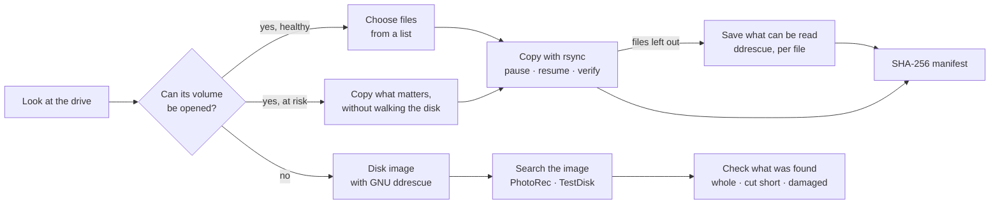
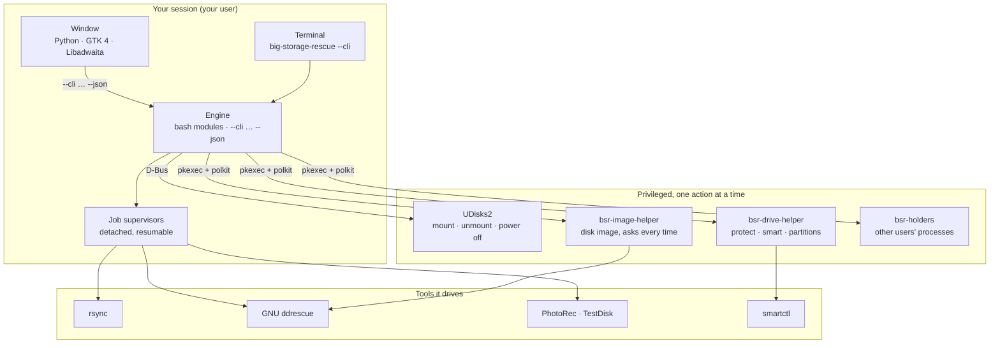
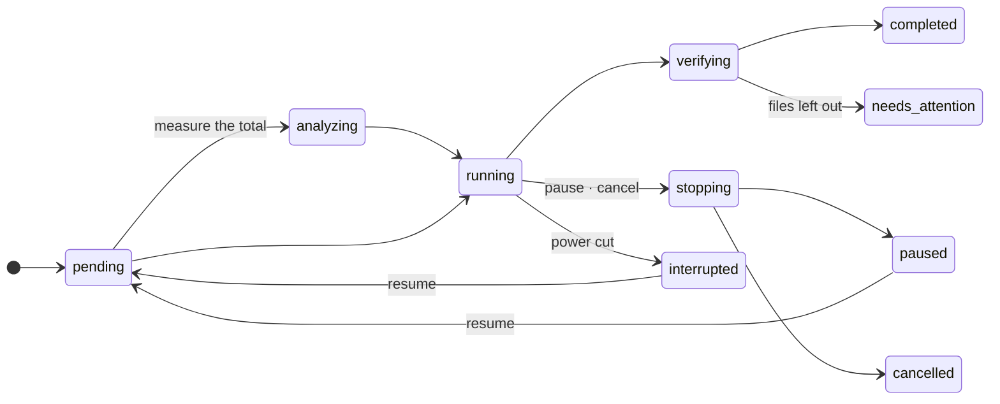

<p align="center">
  
</p>

<h1 align="center">Big Storage Rescue</h1>

<p align="center">
  <b>Find out what is wrong with a drive, why it cannot be written to or removed,
  and rescue your files from it — without ever writing to the drive that is failing.</b>
</p>

<p align="center">
  <a href="https://github.com/biglinux/big-storage-rescue/actions/workflows/tests.yml"></a>
  <a href="LICENSE"></a>
  <a href="https://www.biglinux.com.br"></a>
  
  
  
</p>

<p align="center">
  Made for <a href="https://www.biglinux.com.br">BigLinux</a> (Manjaro/Arch, KDE Plasma 6, Wayland and X11).
  It also works on GNOME, and every tool works in a terminal, also over SSH.
</p>

<p align="center">
  <picture>
    <source media="(prefers-color-scheme: dark)" srcset="docs/images/app-overview-dark.png">
    
  </picture>
</p>

---

## Contents

- [What it does](#what-it-does)
- [Screenshots](#screenshots)
- [Installation](#installation)
- [Getting started](#getting-started)
- [Rescue files, step by step](#rescue-files-step-by-step)
- [Health of a drive](#health-of-a-drive)
- [The running system](#the-running-system)
- [Why can't I write here?](#why-cant-i-write-here)
- [Busy devices and safe removal](#busy-devices-and-safe-removal)
- [The command line](#the-command-line)
- [How it works](#how-it-works)
- [Safety](#safety)
- [Big-Mount and Big Storage Rescue](#big-mount-and-big-storage-rescue)
- [Troubleshooting](#troubleshooting)
- [Development](#development)
- [Known limitations](#known-limitations)
- [Documentation](#documentation)
- [License](#license)

## What it does

| | |
| --- | --- |
| 🗂️ **Every drive at a glance** | internal and external, mounted or not: NVMe, SATA, USB, SD, eMMC, disk images, LUKS and LVM. Each one gets its health in one word (*Critical, Poor, Good, Healthy*) and the facts behind it |
| 🩺 **Health** | SMART and NVMe health (temperature, hours, wear, errors, the last self-test), the kernel log of this boot and of earlier ones, and the error counters of Btrfs and ext4. All of it is read without touching the disk |
| 💻 **The running system** | checked on the drive the computer started from only: a full system, Btrfs without room to grow, partitions os-prober left mounted |
| 🔒 **Why can't I write here?** | Windows Fast Startup, filesystem errors, write-protected cards, permissions, another operating system… explained in plain words, and fixed when that is safe |
| ⏏️ **Busy devices and safe removal** | which programs keep a device busy, and what else does (another mount, swap, a container, a service); then unmount, lock encrypted volumes and power off, without forcing anything |
| 🛟 **Rescue files** | copies files off a failing disk with real progress, pause and resume (also after a power cut), and a check of the result |
| 🧩 **What a copy left out** | files a copy could not finish are read again block by block with GNU ddrescue. This resumes at any point, and saves what can be read, never under the name of a good file |
| 🗺️ **Map of the disk** | a disk image shows what has been read, what could not be, and what is left, drawn from ddrescue's map |
| 🔍 **Whole or not** | files found by content are checked by their structure: *complete*, *cut short* or *damaged* |
| #️⃣ **Manifests** | SHA-256 of what a copy, a salvage or a disk image wrote, to check later with `sha256sum -c` |
| 🔎 **When files cannot be reached** | a disk image with GNU ddrescue, lost partitions with TestDisk, files by content with PhotoRec |
| 📄 **Reports** | technical reports of a drive or of a copy, anonymized on request |

> [!IMPORTANT]
> It never does any of these to the drive it rescues from: format it, repair
> it, rewrite its partition table, force an unmount or kill programs. Secure
> Erase is not part of this tool. See [Safety](#safety).

## Screenshots

The pictures are of the real window, drawn from sample drives
(`tests/readme-screenshots.py`), so they never show anyone's disks or files.
On GitHub they follow your light or dark theme.

<table>
  <tr>
    <td width="50%" align="center">
      <picture>
        <source media="(prefers-color-scheme: dark)" srcset="docs/images/app-health-dark.png">
        
      </picture>
      <br><sub><b>A failing disk</b>: what was found, and what to do</sub>
    </td>
    <td width="50%" align="center">
      <picture>
        <source media="(prefers-color-scheme: dark)" srcset="docs/images/app-health-system-dark.png">
        
      </picture>
      <br><sub><b>The system drive</b>: healthy, but the system is running out of room</sub>
    </td>
  </tr>
  <tr>
    <td align="center">
      <picture>
        <source media="(prefers-color-scheme: dark)" srcset="docs/images/app-rescue-how-dark.png">
        
      </picture>
      <br><sub><b>Recover files</b>: the advised way first, with why</sub>
    </td>
    <td align="center">
      <picture>
        <source media="(prefers-color-scheme: dark)" srcset="docs/images/app-rescue-where-dark.png">
        
      </picture>
      <br><sub><b>Where to</b>: never the same physical disk</sub>
    </td>
  </tr>
  <tr>
    <td align="center">
      <picture>
        <source media="(prefers-color-scheme: dark)" srcset="docs/images/app-job-running-dark.png">
        
      </picture>
      <br><sub><b>A copy in progress</b>, with real numbers</sub>
    </td>
    <td align="center">
      <picture>
        <source media="(prefers-color-scheme: dark)" srcset="docs/images/app-salvage-dark.png">
        
      </picture>
      <br><sub><b>What a copy left out</b>, saved with what could be read</sub>
    </td>
  </tr>
  <tr>
    <td align="center">
      <picture>
        <source media="(prefers-color-scheme: dark)" srcset="docs/images/app-image-map-dark.png">
        
      </picture>
      <br><sub><b>Map of the disk</b> while an image is made</sub>
    </td>
    <td align="center">
      <picture>
        <source media="(prefers-color-scheme: dark)" srcset="docs/images/app-results-checked-dark.png">
        
      </picture>
      <br><sub><b>Checked</b>: what is cut short is said by name</sub>
    </td>
  </tr>
  <tr>
    <td align="center">
      <picture>
        <source media="(prefers-color-scheme: dark)" srcset="docs/images/app-results-dark.png">
        
      </picture>
      <br><sub><b>Results</b> of a search by content</sub>
    </td>
    <td align="center">
      <picture>
        <source media="(prefers-color-scheme: dark)" srcset="docs/images/app-overview-grid-dark.png">
        
      </picture>
      <br><sub><b>Home</b> as a grid</sub>
    </td>
  </tr>
</table>

<details>
<summary><b>More pictures</b>: the first start, a drive, each step of the assistant, dialogs, a narrow window</summary>

| | |
| --- | --- |
|  |  |
|  |  |
|  |  |
|  |  |
|  |  |

</details>

## Installation

### From the BigLinux repository

```bash
sudo pacman -Syu big-storage-rescue
```

### Build the package yourself

```bash
git clone https://github.com/biglinux/big-storage-rescue.git
cd big-storage-rescue/pkgbuild && makepkg -si
```

To try changes that are not committed yet, build from your checkout instead.
It uses the same PKGBUILD and downloads nothing:

```bash
pkgbuild/build-local.sh -si
big-storage-rescue --version     # the revision ends in -dirty when something was not committed
```

Details: [docs/14](docs/14-packaging.md).

Nothing runs at boot and nothing is enabled: the application opens when you
open it.

### Dependencies

pacman installs these with the package:

| Package | Used for |
| --- | --- |
| `bash`, `util-linux` | the engine; `lsblk`, `findmnt`, `blkid`, `flock`, `setpriv`, `setsid`, `ionice`, `mountpoint` |
| `udisks2`, `glib2` | mounting, unmounting and powering drives off as the user (`udisksctl`, `gdbus`) |
| `polkit` | the administrator password for the small helpers (`pkexec`) |
| `lsof` | which programs keep a device busy |
| `rsync` | every copy of files |
| `smartmontools` | the health of a drive (`smartctl`) |
| `diffutils` | keeping the map of a disk image safe (`cmp`) |
| `python`, `python-gobject`, `gtk4`, `libadwaita` ≥ 1.5, `pango`, `gdk-pixbuf2`, `hicolor-icon-theme` | the application and its dialogs |
| `python-cairo` | drawing the map of a disk image |
| `libnotify` | notifications (`notify-send`) |

Commands of the base system (coreutils, findutils, gawk, grep, sed, procps-ng,
systemd) are used too, and are not listed.

Optional, used when present:

| Package | Adds |
| --- | --- |
| `ddrescue` | disk images of a failing drive, and saving what can be read of files a copy left out |
| `testdisk` | lost partitions (TestDisk) and files by content (PhotoRec) |
| `dolphin` | the **Storage device** actions of the right-click menu |
| `big-mount` | mounting the internal partitions at boot |

```bash
sudo pacman -S --needed ddrescue testdisk    # recommended for rescue work
```

### Coming from Big-Mount 2.x

The drive manager of Big-Mount 2.x is now this application. The first time Big
Storage Rescue opens, it brings over:

- copies and images started in Big-Mount;
- the preferences of the window;
- the read-only notifier.

The originals stay in `~/.local/state/big-mount` as a backup. A paused copy
resumes here with what it already wrote. A job that is still running in
Big-Mount is left alone, and brought over when it ends. To see what would
happen, without changing anything:

```bash
big-storage-rescue --migrate-state --dry-run
```

### Uninstall

```bash
sudo pacman -R big-storage-rescue
```

Your jobs and preferences stay in `~/.local/state/big-storage-rescue` and
`~/.config/big-storage-rescue` until you delete them.

## Getting started

| From | How |
| --- | --- |
| The menu | **Big Storage Rescue** |
| Dolphin | right-click a folder → **Storage device** → *Why can't I write here?*, *Safely remove*, *Check the health of this drive*, *Recover files from this drive…*, *Open in Big Storage Rescue* |
| A terminal | `big-storage-rescue` (the window in a graphical session, menus otherwise) |
| SSH | `big-storage-rescue --cli` |

## Rescue files, step by step



**1. Look at the drive.** Home lists every drive with its health in one word
and an icon, never by colour alone. A drive that was not examined is never
shown as *no alerts*.

**2. Recover files** opens an assistant: *from where → what → how → where to →
confirm*. Going back loses nothing. The way advised first depends on the
drive:

| The drive | Advised first |
| --- | --- |
| a healthy volume | a list of the files, to choose from |
| a drive at risk | a copy of what matters, without walking the whole disk |
| a volume that cannot be opened | a disk image first, then a search in the image |

**3. Follow the job.** It runs in the background, with or without the window.
The page shows:

- the current file;
- files and bytes done;
- speed, elapsed and remaining time;
- files that failed or were set aside.

Pause and resume are shown only for the jobs that support them.

**4. What was left out.** On a failing disk, a file with a bad sector, or one
that stopped advancing, is set aside so that the rest is saved first. When the
copy ends, **Save what can be read…** reads those files again with GNU
ddrescue, good areas first and block by block, so a pause or a power cut
resumes where it stopped:

- a file read completely goes to its place;
- a file with unreadable areas goes to *Partly recovered files*, with zeros
  where nothing could be read and a list of those areas. It never gets the name
  of a good file.

**5. Results.** These words never mean the same thing:

| Word | Meaning |
| --- | --- |
| **Found** | a file listed on the volume |
| **Candidate** | a file PhotoRec rebuilt from its content: no name, maybe incomplete |
| **Recovered** | a file written to the destination and synced |
| **Verified** | a recovered file compared with the source, and equal |
| **Partly recovered** | a file saved with areas that could not be read (zeros there, listed) |

Files found by content are also checked by their structure. A photo without
its end, a video without its index or a document without its directory is
marked *Cut short* or *Damaged*.

> [!NOTE]
> *Whole* does not prove every byte is right: open the files that matter.

## Health of a drive

Health is read, never tested: no self-test is started, and no sector is read
on purpose.

| Source | What it tells |
| --- | --- |
| SMART / NVMe health | the drive's own report: reallocated and pending sectors, wear, temperature, hours, the result of the last self-test |
| The kernel log of this boot | read errors, timeouts, resets, a link that slowed down |
| The kernel log of earlier boots | the same, for internal drives, when the drive on that port is the same model and firmware (or the same PCI address) as now |
| Btrfs and ext4 error counters | errors the filesystem recorded, which survive a restart |

| Grade | Meaning |
| --- | --- |
| **Critical** | failing now: copy your files before anything else |
| **Poor** | something is not right, or the flash is worn out: copy what matters |
| **Good** | no alert, but with a note: SMART could not be read, wear, many hours, heat, or SMART values that were low in the past |
| **Healthy** | no alert and no note, with the drive's own report (SMART) read |
| **Not assessed** | nothing could be read yet: never shown as "no alerts" |
| **Not applicable** | a disk image, which has no health of its own |

Errors that happened only in earlier boots are shown in the window, but not
announced at every login. Details: [docs/05](docs/05-readonly-diagnostics.md),
[docs/18](docs/18-system-and-history-checks.md).

## The running system

Some checks only mean something for the drive the computer started from. A
full USB stick is its owner's business, not a fault. So these checks are made
**only on the system drive**:

| Check | Where | Why there |
| --- | --- | --- |
| Free space of `/`, `/home`, `/boot`, `/var`… | the system drive | a full system breaks updates and loses settings; `/boot` without room breaks a kernel update |
| Btrfs unallocated space and metadata | the system drive | Btrfs can say "no space left" while free space is still shown |
| Partitions os-prober left mounted | whichever drive holds the partition | that partition cannot be removed or checked until it is released |
| Errors in earlier boots | internal drives | USB ports and `sdX` names are reused by other drives |
| Filesystem error counters | any mounted Btrfs or ext4 | they are stored on the drive itself |

What to do is explained. What needs an administrator (`btrfs balance`,
`umount`) is shown as a command to read, never run from here. Details:
[docs/18](docs/18-system-and-history-checks.md).

## Why can't I write here?

```bash
big-storage-rescue --diagnose /run/media/me/PENDRIVE
```

Or Dolphin → **Storage device** → **Why can't I write here?**. The diagnosis
checks the hardware and the kernel log before permissions, so a damaged drive
is never presented as a simple restriction, and a restriction is never
presented as damage. Details: [docs/05](docs/05-readonly-diagnostics.md).

## Busy devices and safe removal

```bash
big-storage-rescue --busy /run/media/me/PENDRIVE
big-storage-rescue --safe-remove /run/media/me/PENDRIVE [--close-apps]
```

- The programs keeping a device busy are named, with what they are doing.
- Closing them is offered only for your own programs that are not writing, and
  only after you confirm.
- Services that would stop are listed first.
- Internal disks are unmounted, never powered off.

Details: [docs/06](docs/06-busy-processes.md), [docs/07](docs/07-safe-removal.md).

## The command line

Every operation of the window is a command, and the window runs those same
commands, so the two always agree. `--json` gives stable machine-readable
output, and `--dry-run` says what would be done without changing anything.

```bash
big-storage-rescue --cli                 # interactive menus, in any terminal
big-storage-rescue --cli --help          # every command
big-storage-rescue --doctor              # check the installation and the storage stack
```

### Commands

<details open>
<summary><b>Drives</b></summary>

| Command | What it does |
| --- | --- |
| `list` | storage devices and what is known about their health |
| `inspect TARGET` | everything known about one drive |
| `resolve TARGET` | which drive a device, folder or UUID is |
| `diagnose TARGET [--smart]` | explain its state; `--smart` also reads SMART (asks for a password) |
| `mount DEV [--read-only \| --protect \| --remount \| --read-write]` | mount a volume without changing it (read-only is the default; `--read-write` is refused on a drive at risk) |
| `unmount TARGET` | unmount one volume safely; a whole drive: all of its volumes |
| `safe-remove TARGET [--allow-services]` | unmount everything on the drive and power it off |
| `busy TARGET`, `close-apps TARGET` | which programs keep a volume busy; ask yours to close (never the system, never one that is writing) |
| `protect DEV`, `unprotect DEV` | block or allow writing on the device itself (asks for a password) |
| `unlock DEV` | unlock an encrypted volume |
| `report TARGET [--anonymize]` | a technical report of a drive |

</details>

<details open>
<summary><b>Rescue</b></summary>

| Command | What it does |
| --- | --- |
| `methods TARGET` | which ways of recovering files can be used on it, and which is advised |
| `destinations --source FOLDER` | where files can be copied to |
| `copy --source FOLDER --destination FOLDER` | copy files in the background, with progress |
| `image --source DEV --image FILE` | make a disk image with GNU ddrescue (asks for a password every time) |
| `partitions TARGET [--search]` | read the partition table with TestDisk; `--search` also looks for lost ones. Nothing is changed |
| `scan --source FOLDER` | list the files that exist in a folder, by type |
| `carve --source DEV\|IMAGE --destination FOLDER [--categories LIST]` | search for files by content with PhotoRec (`photos,videos,documents,audio,archives`) |
| `salvage ID [--retries N]` | read again the files a copy left out, and save what can be read of each |

Options of `copy`:

| Option | |
| --- | --- |
| `--item PATH`, `--items-from FILE`, `--results-of ID` | copy only some files or folders, or what a search found |
| `--on-conflict skip\|backup\|overwrite` | files that already exist: keep them (default), keep them aside, replace them |
| `--verify basic\|metadata\|full` | how to check the result (`full` reads the source again) |
| `--stall-seconds N` | set aside a file that does not advance for N seconds (default 90, 0: never) |
| `--bwlimit KBPS` | limit the reading speed |
| `--scan auto\|yes\|no` | measure the total first (`auto`: not on a drive at risk) |
| `--allow-same-disk` | accept a destination on the same physical disk (if that disk fails, both are lost) |
| `--allow-rw-source` | accept a drive at risk that is already mounted with writing enabled (see [Safety](#safety)) |
| `--allow-risky-destination` | accept a destination on a drive with critical alerts |
| `--no-wait` | start and return; the copy continues in the background |

</details>

<details open>
<summary><b>Jobs and results</b></summary>

| Command | What it does |
| --- | --- |
| `jobs` | copies, images, searches and salvages, running and past |
| `status ID [--watch]` | progress of one of them |
| `pause ID`, `cancel ID` | stop it safely. A copy, an image or a salvage can be paused; a search can only be cancelled, and what it found stays |
| `resume ID [--retry-deferred]` | continue a copy, an image or a salvage where it stopped, also after a shutdown; optionally try again what was set aside. A search starts again from the beginning |
| `map ID` | what a disk image has read so far, as a map of the disk |
| `results ID` | what a search found |
| `check-files ID` | check again whether the files a search found are whole |
| `manifest ID [--output FILE]` | SHA-256 of what a copy, a salvage or an image wrote (reads the destination only) |
| `report ID [--anonymize] [--output FILE]` | a report of a job |

</details>

### A rescue from the terminal

```bash
# 1. Which drive is it, and how is it?
big-storage-rescue --cli list
big-storage-rescue --cli diagnose /dev/sdb --smart

# 2. Mount it read-only, and block writing on the device itself
big-storage-rescue --cli mount /dev/sdb1 --protect

# 3. Copy what matters, and follow it
big-storage-rescue --cli copy --source /run/media/me/OLD/Photos \
                              --destination /run/media/me/BACKUP --no-wait
big-storage-rescue --cli status ID --watch

# 4. Save what can be read of the files the copy left out: a job of its own,
#    with its own ID (SALVAGE_ID)
big-storage-rescue --cli salvage ID --dry-run
big-storage-rescue --cli salvage ID

# 5. Record what was rescued, one manifest per job, and check it later
big-storage-rescue --cli manifest ID
big-storage-rescue --cli manifest SALVAGE_ID
cd /run/media/me/BACKUP && sha256sum -c ~/.local/state/big-storage-rescue/jobs/ID/manifest.sha256
```

When the volume cannot be opened at all:

```bash
big-storage-rescue --cli image --source /dev/sdb --image /run/media/me/BACKUP/sdb.img
big-storage-rescue --cli map ID                  # read ###, unreadable XX, to retry ~~, not yet ..
big-storage-rescue --cli carve --source /run/media/me/BACKUP/sdb.img \
                               --destination /run/media/me/BACKUP/found --categories photos,documents
big-storage-rescue --cli results ID
```

### Exit codes

| Code | Meaning | Code | Meaning |
| --- | --- | --- | --- |
| 0 | done | 9 | not done: services depend on it and were not confirmed |
| 1 | error | 10 | another operation on the same drive or job is in progress |
| 2 | usage | 20 | refused by a safety check |
| 3 | device busy | 21 | not enough space |
| 4 | refused: it holds the running system | 22 | finished, but some files were not copied, or the check found differences |
| 5 | not authorized, or cancelled | 23 | cancelled or paused |
| 6 | unmounted, but still in use by a stacked device | 24 | a device went away or did not answer |
| 7 | unmounted; this drive cannot be powered off | 25 | a tool is missing (ddrescue, testdisk, smartctl, rsync, GTK) |
| 8 | unmounted, but powering it off failed | | |

### Other options

| Option | |
| --- | --- |
| *(none)* | the application in a graphical session, the menus in a terminal |
| `--gui [TARGET]`, `--gui-health`, `--gui-rescue` | the application, opened on a drive, its health or the recovery |
| `--diagnose [TARGET]`, `--busy`, `--unmount`, `--safe-remove` | diagnosis and removal |
| `--gui-diagnose`, `--gui-remove` | the Dolphin actions |
| `--notifier` | warns about read-only devices (off by default; turn it on in the menu) |
| `--migrate-state [--dry-run]` | bring over the state of Big-Mount 2.x |
| `--doctor`, `--version`, `--help` | |

More examples: [docs/11](docs/11-cli.md).

<details>
<summary>What <code>--doctor</code> looks like</summary>

```text
Big Storage Rescue check (nothing is changed; labels, serial numbers, UUIDs and personal paths are left out)

Big Storage Rescue
  [INFO] Big Storage Rescue 1.0.0, 1a2b3c4 (2026-11-02T10:00:00Z)
  [ OK ] Installed files match the package

Desktop session
  [ OK ] Drive manager, copying files off a drive: rsync
  [ OK ] Drive manager, SMART details: smartctl
  [ OK ] Drive manager, disk images: ddrescue
  [ OK ] Application and dialogs: GTK 4 and libadwaita

Storage stack
  [ OK ] UDisks2 answers on the system D-Bus
  [ OK ] Polkit knows the action of Big Storage Rescue
  [ OK ] nvme0n1: nvme, 1 TB, internal
  [WARN] sdb: the drive reports problems (timeouts io-errors)
         For details: big-storage-rescue --diagnose /dev/sdb

Running system
  [ OK ] Enough free space, and nothing left mounted by os-prober

Result: 0 problem(s), 1 warning(s).
To report a problem, attach this output: big-storage-rescue --doctor > big-storage-rescue-report.txt
```

</details>

## How it works

### Architecture



- **One engine.** The window never calls a tool itself: it asks the engine
  (`--cli COMMAND --json`) and shows the answer. So the window cannot show
  something the engine does not say, every feature can be tested without a
  display, and everything works over SSH.
- **Jobs outlive the window.** A copy, image, search or salvage runs in a
  detached supervisor. The window, `--cli status ID --watch` and the
  notifications only read its state file.
- **No root daemon.** The window and the engine run as you. Mounting goes
  through UDisks2. What needs root is a small helper started through pkexec
  for one operation, with its arguments treated as untrusted. It ends with
  that operation: for a disk image, when ddrescue ends, which on a failing
  drive can take hours.

Details: [docs/03](docs/03-architecture.md).

### Privileges

| polkit action | Runs | Password |
| --- | --- | --- |
| `org.biglinux.big-storage-rescue.image` | `bsr-image-helper`: reads a whole drive into an image | **every time** (`auth_admin`) |
| `org.biglinux.big-storage-rescue.drive-helper` | `bsr-drive-helper protect`, `unprotect`, `smart`, `partitions` | once, kept a few minutes (`auth_admin_keep`) |
| `org.biglinux.big-storage-rescue.inspect-processes` | `bsr-holders`: which processes of other users keep a device busy | once, kept a few minutes |

pkexec picks the action by the path of the program alone, so each action has
a program of its own. `bsr-image-helper` hands the work to `bsr-drive-helper
image`, which refuses to run when it was not started that way: the action that
keeps the password never reaches a disk image.

The helper refuses to image a drive of the running system, and never writes the
image or its map on the disk being read. It works that out for whatever holds
the folder: a partition, LUKS, LVM, RAID, every device of a Btrfs, a loop
device over a file on that disk. A folder whose disk cannot be told (an
overlay, FUSE without a device, a share served by this computer) is refused. It
opens the user's files without following links, and checks the disk sequence number
right before acting, so a drive swapped during the password dialog is never
touched. Details: [docs/12](docs/12-security.md).

### The tools, and how they are used

| Tool | How |
| --- | --- |
| **rsync** | `-rlt -8 --one-file-system --no-specials --no-devices --fsync`, into a temporary folder, then renamed: a file with its final name is complete, also after a power cut. Runs under `ionice`/`nice`. A file that stops advancing is set aside and the copy goes on |
| **GNU ddrescue** | images: `--idirect --no-scrape`, map saved every 5 s with a backup; retries only when asked. Salvage: one map per file, `--extend-outfile`, so a pause resumes block by block |
| **PhotoRec** | by categories, `/nolog /cmd`, into a folder that is not inside the source; then each file found is checked by `integrity.py` |
| **TestDisk** | `/list` and `analyze` only: the partition table is read, never written |
| **smartctl** | `-H -A -i -l selftest`: reads the report, never starts a test |
| **UDisks2** | mount (read-only by default), unmount, unlock, power off, as the user |

### Jobs

Each job has a folder, `~/.local/state/big-storage-rescue/jobs/ID/` (mode 700):

| File | |
| --- | --- |
| `job.conf` | what was asked: source, destination, their UUIDs, options |
| `state.env` | how far it got, replaced atomically once a second |
| `events.log`, `rsync.out` | the record of what was copied, and errors |
| `failed.txt`, `deferred.txt` | files that could not be read, or were set aside |
| `maps/`, `holes.tsv` | salvage: the map of each file, and its unreadable areas |
| `index`, `integrity` | search: what was found, and whether each file is whole |
| `manifest.sha256` | SHA-256 of what was written |
| `lock` | held by the supervisor while it runs |



### Files it keeps

| Where | What |
| --- | --- |
| `~/.local/state/big-storage-rescue/` | jobs, their logs and reports |
| `~/.config/big-storage-rescue/` | preferences of the window |
| `~/.config/autostart/big-storage-rescue-notifier.desktop` | the read-only notifier, only when you turn it on |
| `/usr/lib/big-storage-rescue/` | the engine, the application and the helpers |
| `/usr/share/polkit-1/actions/org.biglinux.big-storage-rescue.policy` | the three polkit actions |
| `/usr/share/kio/servicemenus/big-storage-rescue.desktop` | the Dolphin menu |

Nothing is kept in `/etc`, and nothing is installed as a service.

## Safety

- **It runs as your user.** Anything that needs more goes through UDisks2 and
  polkit, or through small helpers run by pkexec with the administrator
  password. There is no daemon, and nothing stays running.
- **A disk image asks for the password every time**, and a drive of the
  running system is never imaged: a raw copy holds the files of every user.
- **A drive at risk is mounted read-only**, and can be blocked at the device
  level. A copy refuses a drive at risk that is already mounted with writing
  enabled. `copy --allow-rw-source` accepts it anyway: the system may then write
  to it during the copy (its journal, access times), which wears a failing
  disk and changes it. Remount it read-only instead whenever you can.
- **Destination checks:**
  - never inside the source;
  - never on the same physical disk, through partitions, LUKS and LVM (unless
    you insist in the terminal);
  - a disk image never on the disk being read, whatever holds the folder, and
    never in a folder whose disk cannot be told;
  - enough room;
  - existing files kept.
- **Device names are never trusted across time:** the disk sequence number is
  checked before every operation that cannot be undone.
- **A mount that hangs does not hang the program** (FUSE on a failing disk, a
  share that went away): the questions that could block have a time limit.
- **Files found on a disk are never run:** thumbnails have size and pixel
  limits, and the integrity check reads structure only.
- **Secure Erase, formatting and repairs are not part of this tool.**

> [!WARNING]
> When the hardware itself is failing (heads, controller, firmware, NAND), no
> software can fix it. Each attempt to read wears the drive further. If the
> data is very important, stop, and consider a data recovery professional
> before trying again.

Details: [docs/12](docs/12-security.md).

## Big-Mount and Big Storage Rescue

| | Big-Mount | Big Storage Rescue |
| --- | --- | --- |
| Mounts internal partitions at boot | yes | no |
| Runs at boot | yes, `big-mount.service` | never |
| Diagnosis, busy devices, safe removal, health, rescue | no | yes |
| Graphical interface | no | yes |

They are independent packages: you can install both, either one, or neither,
without file conflicts. When Big-Mount is present, Big Storage Rescue:

- reads what Big-Mount left in `/run/big-mount/status`, to explain why a
  partition was mounted read-only at boot;
- shows Big-Mount's state in `--doctor`.

It never changes Big-Mount's configuration or restarts its service.

## Troubleshooting

| Problem | What to do |
| --- | --- |
| Something does not work as described | `big-storage-rescue --doctor` checks the installation, the session and the storage stack; attach its output to a report |
| A drive says *Not assessed* | nothing could be read yet: open its **Health** page and read SMART |
| Home says *a mounted device did not answer in time* | a mounted volume hangs (often a failing disk, or FUSE over one). Every drive is still listed after a few seconds, without its free space |
| A job says *Stopping: waiting for the disk to answer* | a read is stuck inside the driver; it ends when the disk answers. Nothing is killed, so no file is left half-written |
| `--doctor` says the menu entry was changed | on BigLinux, *render-menu-options* adds the graphics card options to every menu entry: expected |
| Nothing happens when asked for the password | a polkit agent must be running in your session (Plasma and GNOME have one). Over SSH, use `sudo big-storage-rescue --cli …`: everything then runs as root, with root's jobs, and a disk image goes only into a folder that belongs to root |

## Development

```text
big-storage-rescue/usr/bin/big-storage-rescue    entry point
big-storage-rescue/usr/lib/big-storage-rescue/   engine (bash), application (Python, GTK 4), helpers
locale/                                          gettext catalog and templates
pkgbuild/                                        PKGBUILD, build-local.sh
tests/                                           test suites
docs/                                            technical documentation (00–21)
```

Run it from the checkout without installing:

```bash
BSR_LIB=$PWD/big-storage-rescue/usr/lib/big-storage-rescue bash big-storage-rescue/usr/bin/big-storage-rescue --doctor
```

### Tests

No test touches a real disk. They run on every pull request, in an Arch Linux
container.

```bash
bash tests/lib-tests.sh        # diagnosis, process policy, health, the running system
bash tests/drive-tests.sh      # drive manager with fixtures; real rsync and GNU ddrescue on scratch files
bash tests/migrate-tests.sh    # state of Big-Mount 2.x, a real resume
bash tests/i18n-tests.sh       # translations
bash tests/package-check.sh    # package() on this checkout
python3 tests/gui-tests.py     # the window, on a private Broadway display
python3 tests/gui-e2e.py       # the window with the real engine, on scratch files
```

`tests/integration.sh` and `tests/drive-integration.sh` use real loop devices,
and need a local session with UDisks2. Details: [docs/15](docs/15-testing.md).

### Pictures, translations, history

```bash
LC_ALL=C.UTF-8 python3 tests/readme-screenshots.py          # the pictures of this README
LC_ALL=C.UTF-8 python3 tests/readme-screenshots.py --dark
locale/update-pot.sh && locale/compile.sh                   # after translating (docs/13)
```

### Packages

BigLinux builds the package from the `testing-…` and `stable-…` branches
that its release flow creates after a merge to `main`.
`.github/workflows/build-package.yml` is the one of the BigLinux package
template, byte for byte: the old request to the build service is commented
out there, as its organization and token no longer answer (401). There is no
machine translation in CI: the catalogs are translated and reviewed in
`locale/`, and `locale/compile.sh` puts them in the package tree. Besides English and
Brazilian Portuguese: Spanish, German, French, Italian, Russian, Simplified
Chinese, Japanese, Polish and Turkish (docs/13).

Architecture and decisions: [docs/03](docs/03-architecture.md). The history of
the code, from Big-Mount 2.0 to 2.6, is kept in git and in
[docs/big-mount-history](docs/big-mount-history).

## Known limitations

- **A copy resumes per file:** an interrupted large file starts over in the
  copy itself. What the copy left out is then saved block by block by *Save
  what can be read…*, which resumes anywhere.
- **An image with unreadable areas does not yet say which files they hit.**
- **`--protect` lasts until the drive is disconnected.** Clicking a failing
  disk in Dolphin mounts it with writing enabled before this program can
  protect it: that is the policy of UDisks2 and the desktop.
- **XFS and Btrfs with an unclean log** cannot be mounted through UDisks2
  without replaying it.
- **The first read of a damaged area can take minutes,** and `cancel` waits
  for it.
- **Owners are not preserved:** a copy does not run as root. A file of 4 GiB
  or more cannot go to FAT32, and is listed as failed.
- **As a user, only your own processes are listed;** the others need the
  password.
- **Plasma does not let other programs add actions to its own unmount error:**
  the diagnosis lives in the Dolphin menu, the launcher and the terminal.
- **Not validated on real hardware by this project yet:**
  - the password dialog of the helper, and the helper running as root;
  - LVM, RAID, multi-device Btrfs, SD and eMMC (detected from fixtures);
  - a screen reader, and a real GNOME session.

  GNU ddrescue runs for real in the tests, with simulated bad sectors on
  scratch files, and was used in the field by Big-Mount 2.6.

## Documentation

| | | |
| --- | --- | --- |
| [00 Audit of the state found](docs/00-world-class-audit.md) | [20 Global benchmark](docs/20-global-benchmark.md) | [21 What was done, and validated](docs/21-world-class-progress.md) |
| [01 Source audit](docs/01-source-audit.md) | [07 Safe removal](docs/07-safe-removal.md) | [13 Translations](docs/13-i18n.md) |
| [02 Migration plan](docs/02-migration-plan.md) | [08 Recovery engine](docs/08-recovery-engine.md) | [14 Packaging](docs/14-packaging.md) |
| [03 Architecture](docs/03-architecture.md) | [09 Copy and resume](docs/09-copy-and-resume.md) | [15 Testing](docs/15-testing.md) |
| [04 Device detection](docs/04-device-detection.md) | [10 GTK and Libadwaita](docs/10-gtk-libadwaita-ux.md) | [16 Migration validation](docs/16-migration-validation.md) |
| [05 Read-only diagnostics](docs/05-readonly-diagnostics.md) | [11 Command line](docs/11-cli.md) | [17 Final report](docs/17-final-report.md) |
| [06 Busy processes](docs/06-busy-processes.md) | [12 Security](docs/12-security.md) | [18 System and history checks](docs/18-system-and-history-checks.md) |

## License

[GNU General Public License v3.0 or later](LICENSE). Big Storage Rescue started
from the code of Big-Mount, by the BigLinux team; the full history and
authorship are in git.
